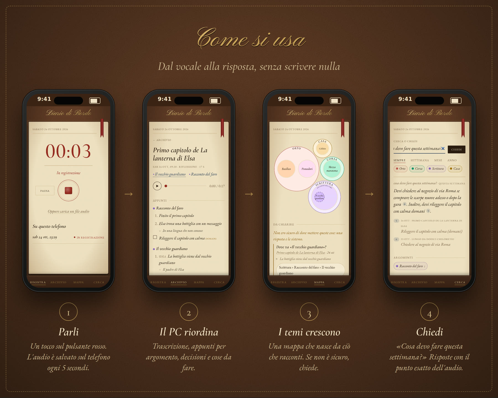
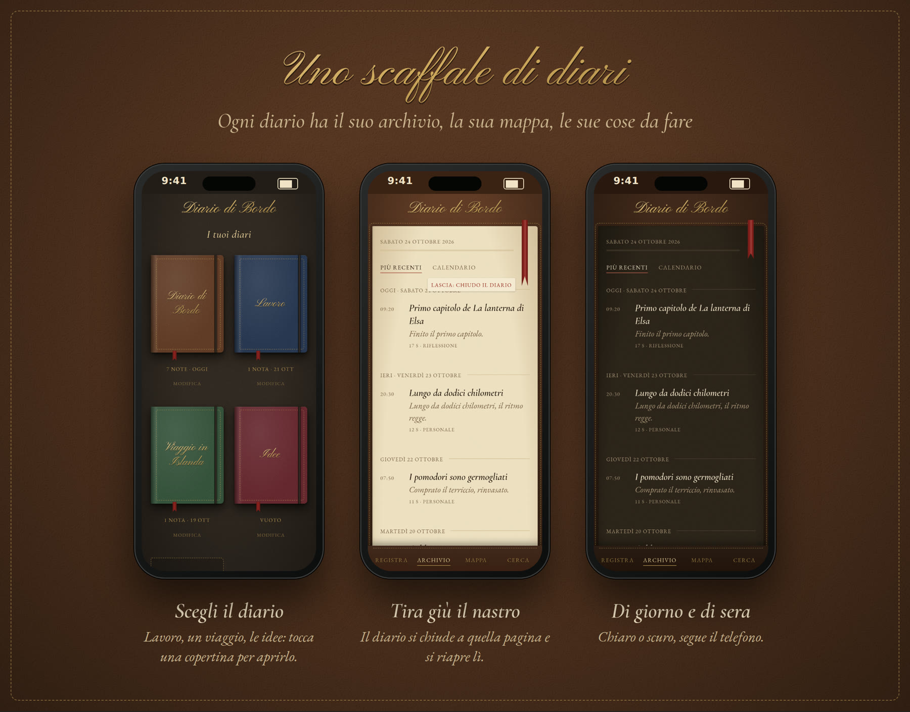
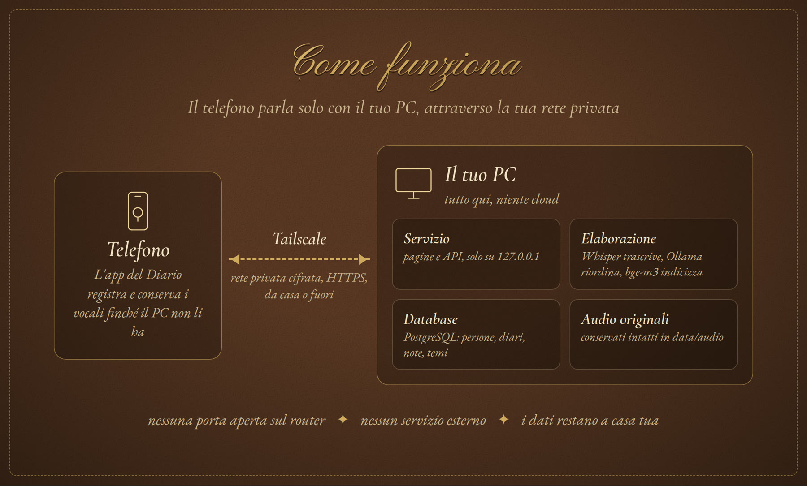
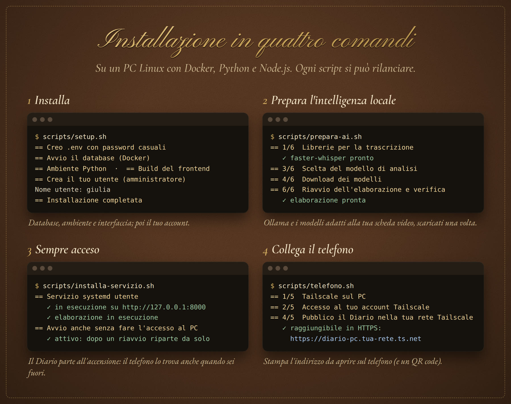
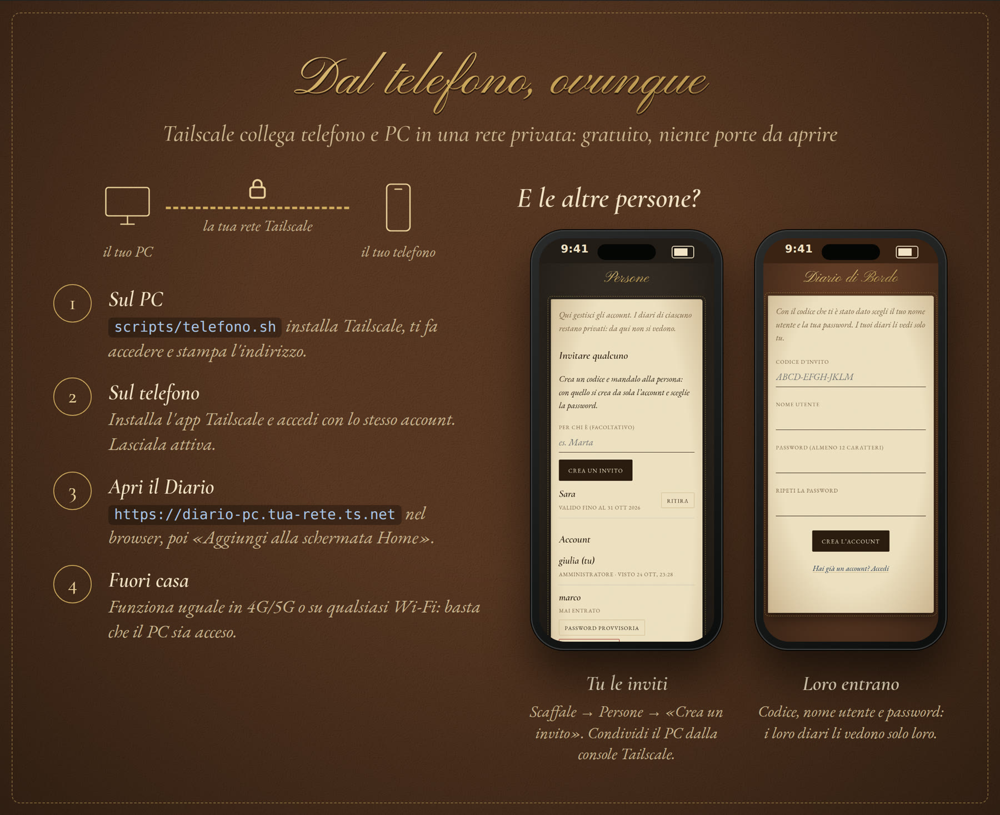
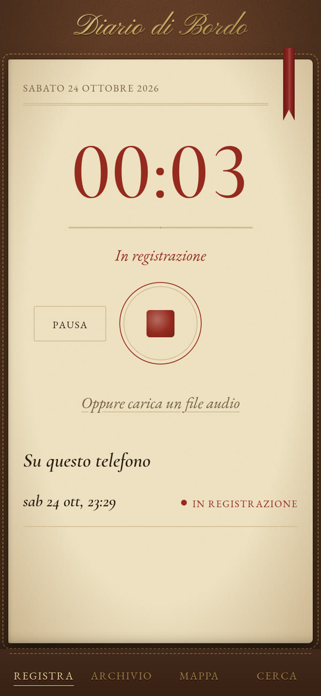
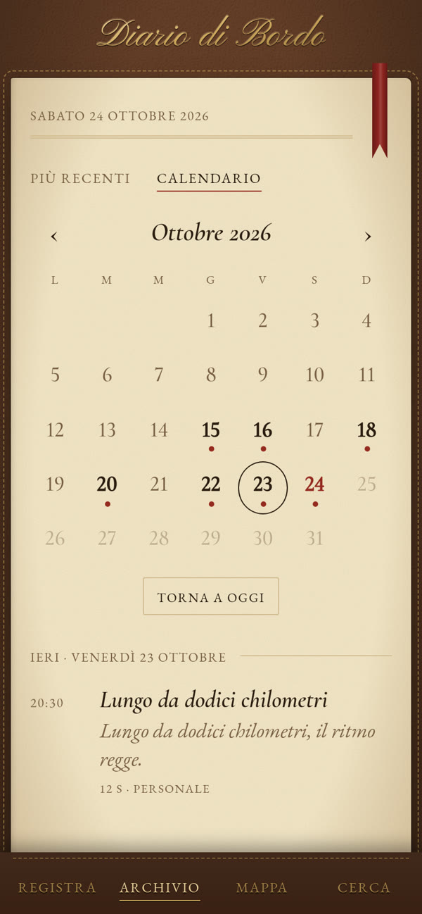
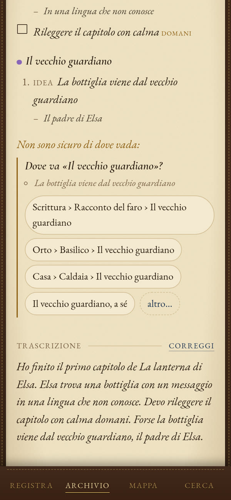
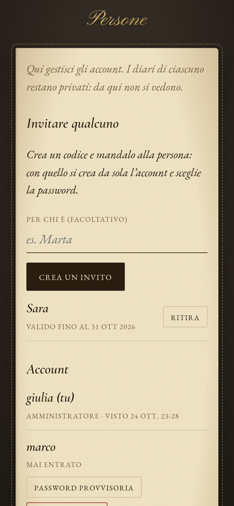

# Diario di Bordo

<p align="center">
  
</p>

Un diario vocale personale che vive sul tuo PC. Registri dal telefono, l'audio arriva al PC,
viene trascritto e riorganizzato in appunti, cose da fare e una mappa dei temi che cresce con
ciò che racconti. Poi puoi cercare o fare domande in italiano ("cosa ho deciso col
commercialista?"). **Tutto in locale**: trascrizione e analisi girano sul PC, nessun dato
lascia casa tua.

- **Registra dal telefono** come app (PWA): salvataggio ogni 5 secondi, invio che riprende da
  solo se la rete cade, nulla si perde se la pagina si chiude.
- **Note ordinate da sole**: trascrizione (faster-whisper), appunti per argomento, decisioni,
  domande aperte, cose da fare con la frase che le giustifica, chi parla (pyannote).
- **Una mappa dei temi** che nasce da ciò che dici, senza categorie decise in anticipo; quando
  non è sicuro, chiede.
- **Cerca o chiedi**: ricerca per parole e per significato, risposte con i rimandi al punto
  esatto dell'audio.
- **Più diari** per persona (*Lavoro*, *Viaggio*, *Idee*…), ciascuno separato dagli altri,
  su uno scaffale di quaderni di cuoio; si chiudono tirando giù il nastro segnalibro.
- **Più persone** sullo stesso PC, su invito: ognuno vede solo i suoi diari.
- **Raggiungibile ovunque** con Tailscale, senza aprire porte sul router.

## Come si usa

<p align="center"></p>

1. **Parli**: un tocco sul pulsante rosso. L'audio resta sul telefono finché il PC non l'ha ricevuto.
2. **Il PC riordina**: in pochi minuti trovi la trascrizione e gli appunti per argomento, con
   decisioni, domande aperte e cose da fare.
3. **I temi crescono**: ogni argomento trova posto in una mappa che nasce da ciò che racconti.
   Se il Diario non è sicuro di dove metterlo, te lo chiede.
4. **Chiedi**: «cosa devo fare questa settimana?». La risposta rimanda al punto esatto dell'audio.

Tutto il resto, pagina per pagina, è nella **[guida all'uso](docs/guida.md)**.

## Più diari, più persone

<p align="center"></p>

Ogni diario è un mondo a sé: archivio, mappa, cose da fare e ricerca non si mescolano. Per
chiuderne uno **tira giù il nastro rosso** in cima alla pagina: torni allo scaffale, e il diario si
riaprirà a quella pagina. Sullo stesso PC possono esserci più persone, ognuna con il suo account e i
suoi diari: le inviti tu (vedi [sotto](#collegare-il-telefono-con-tailscale)).

## Come funziona

<p align="center"></p>

<details>
<summary>Dettagli tecnici</summary>

```
 telefono (PWA)  ──HTTPS via Tailscale──▶  PC: FastAPI (127.0.0.1:8000) + interfaccia Next.js
   registra, salva a pezzi,                   ├─▶ PostgreSQL 16 + pgvector (Docker, solo localhost)
   invia a blocchi                            └─▶ data/audio/  originali, permessi 0600

 worker ── coda in PostgreSQL ──▶ trascrizione faster-whisper (GPU o CPU)
                                ▶ analisi      Ollama (modello scelto in base alla scheda video)
                                ▶ indice       embedding bge-m3 per la ricerca per significato
```

Scelte e motivazioni in [docs/architettura.md](docs/architettura.md); sicurezza e isolamento tra
persone e tra diari in [docs/sicurezza.md](docs/sicurezza.md).
</details>

## Requisiti

- **Linux** (sviluppato e provato su Ubuntu) con **Docker Engine** e il plugin `docker compose`
- **Python 3.11+** e **Node.js 20+**
- Consigliata una **scheda video NVIDIA** (CUDA) **o AMD** (ROCm, es. Radeon RX 7000/9000): 8 GB
  bastano; senza, si usa la CPU, più lentamente
- Circa **10 GB** di spazio per i modelli
- Per usarlo dal telefono: **[Tailscale](https://tailscale.com)** (gratuito per uso personale)
  su PC e telefono

Ollama, le librerie per la scheda video (CUDA o ROCm) e i modelli li installa lo script
`scripts/prepara-ai.sh`. Se cambi scheda (per esempio da NVIDIA ad AMD) basta rilanciarlo.

## Installazione

<p align="center"></p>

```bash
git clone <indirizzo-del-repository> diario-di-bordo
cd diario-di-bordo
scripts/setup.sh
```

`setup.sh` fa tutto in ordine e alla fine propone i passi successivi; si può rilanciare quando
si vuole (salta quello che è già fatto):

1. crea `.env` con password casuali, avvia il database in Docker, prepara l'ambiente Python,
   compila l'interfaccia;
2. ti chiede **nome utente e password**: sei l'amministratore;
3. **elaborazione** (`scripts/prepara-ai.sh`): Ollama, librerie GPU, scelta e download dei
   modelli, verifica finale;
4. **avvio automatico** all'accensione del PC (`scripts/installa-servizio.sh`);
5. **accesso dal telefono** con Tailscale (`scripts/telefono.sh`): stampa l'indirizzo
   `https://<pc>.<rete>.ts.net` (e un QR code, se è installato `qrencode`).

Ognuno dei passi 3–5 si può fare anche dopo, lanciando lo script corrispondente. Nessuno va
lanciato con `sudo`: la password di amministratore viene chiesta solo dove serve.

## Collegare il telefono con Tailscale

<p align="center"></p>

Il Diario non è su Internet: ascolta solo sul PC. [Tailscale](https://tailscale.com) crea una rete
privata e cifrata tra i tuoi dispositivi (gratuita per uso personale) e fornisce l'HTTPS che il
telefono chiede per usare il microfono. Nessuna porta da aprire sul router.

**Sul PC**, una volta sola:

```bash
scripts/telefono.sh
```

Installa Tailscale se manca, ti fa accedere al tuo account (stampa un link da aprire), controlla
che MagicDNS e i certificati HTTPS siano attivi (se no ti dice dove attivarli), pubblica il Diario
**solo nella tua rete** e stampa l'indirizzo, del tipo `https://<nome-pc>.<rete>.ts.net`.
Lo rivedi quando vuoi con `scripts/telefono.sh --stato`.

**Sul telefono**:

1. installa l'app **Tailscale** (App Store o Play Store) e accedi con lo **stesso account** del PC;
2. lasciala sempre attiva: Android, *VPN sempre attiva*; iPhone, *VPN On Demand* nell'app;
3. apri l'indirizzo `https://…ts.net` nel browser ed entra con utente e password del Diario;
4. **aggiungilo alla schermata Home** (Safari: Condividi → *Aggiungi alla schermata Home*;
   Chrome: ⋮ → *Aggiungi a schermata Home*) e consenti il microfono.

Da quel momento funziona ovunque: a casa, in 4G/5G, su qualsiasi Wi-Fi, purché il PC sia acceso
(`scripts/installa-servizio.sh` lo fa partire da solo all'accensione).

**Altre persone**, ognuna con il suo telefono:

1. nella [console di Tailscale](https://login.tailscale.com/admin/machines), menu `…` accanto al
   PC → **Share…** → la sua email. Lei installa Tailscale con il **suo** account e accetta: vede
   solo il tuo PC;
2. nel Diario, scaffale → **Persone** → *Crea un invito*: il messaggio pronto contiene indirizzo e
   codice;
3. lei apre l'indirizzo, tocca *Hai un invito? Crea il tuo account* e sceglie nome utente e
   password. I suoi diari li vede solo lei.

Problemi e casi particolari (PC che va in sospensione, chiave Tailscale che scade, disco cifrato) in
[docs/accesso-dal-telefono.md](docs/accesso-dal-telefono.md).

## Primi passi

1. **Sul PC** apri <http://localhost:8000>; **sul telefono** l'indirizzo `https://…ts.net`
   (con l'app Tailscale attiva, stesso account del PC). Entra con utente e password.
2. Sul telefono **aggiungi il Diario alla schermata Home** e consenti il microfono.
3. Sullo **scaffale** tocca *Diario di Bordo*, il tuo primo diario.
4. Tocca il **pulsante rosso**, parla, toccalo di nuovo. Dopo qualche minuto la nota è pronta
   nell'**Archivio**; i temi compaiono sulla **Mappa**.
5. Per tornare allo scaffale **tira giù il nastro rosso** in cima alla pagina.
6. Vuoi far entrare qualcuno? Scaffale → **Persone** → *Crea un invito*.

La guida completa è in **[docs/guida.md](docs/guida.md)**.

## Galleria

<table>
  <tr>
    <td align="center" width="25%"><br><sub>Registra</sub></td>
    <td align="center" width="25%"><br><sub>Archivio</sub></td>
    <td align="center" width="25%"><br><sub>Calendario</sub></td>
    <td align="center" width="25%"><br><sub>Nota</sub></td>
  </tr>
  <tr>
    <td align="center"><br><sub>Appunti e domande</sub></td>
    <td align="center"><br><sub>Scheda di un tema</sub></td>
    <td align="center"><br><sub>Cerca</sub></td>
    <td align="center"><br><sub>Chiedi</sub></td>
  </tr>
  <tr>
    <td align="center"><br><sub>Scaffale</sub></td>
    <td align="center"><br><sub>Persone</sub></td>
    <td align="center"><br><sub>Nota, al buio</sub></td>
    <td align="center"><br><sub>Mappa, al buio</sub></td>
  </tr>
</table>

<sub>Persone, diari e note delle immagini sono inventati.</sub>

## Documentazione

| | |
|---|---|
| [docs/guida.md](docs/guida.md) | **Guida all'uso**: scaffale e diari, registrare, archivio, note, mappa, cerca, account |
| [docs/amministrazione.md](docs/amministrazione.md) | **Per chi gestisce il PC**: persone e inviti, aggiornare, backup e ripristino, modelli, log, problemi |
| [docs/accesso-dal-telefono.md](docs/accesso-dal-telefono.md) | Tailscale passo per passo, restare raggiungibili fuori casa |
| [docs/architettura.md](docs/architettura.md) | Scelte tecniche, modello dati, pipeline di elaborazione |
| [docs/sicurezza.md](docs/sicurezza.md) | Autenticazione, isolamento tra persone e tra diari, dove stanno i dati |
| [docs/stato.md](docs/stato.md) | Storia dello sviluppo, cosa è stato provato |

## Comandi

Si lanciano dalla **cartella del progetto**, come utente normale (mai con `sudo`: la password
di amministratore la chiedono gli script quando serve). `NOME` è un nome utente del Diario,
`ID` l'inizio dell'id di una nota (quello dopo `?id=` nell'indirizzo della nota).

**Installazione e manutenzione**

```bash
scripts/setup.sh                          # prima installazione; ripetibile
scripts/prepara-ai.sh                     # librerie per la scheda video (NVIDIA, AMD o CPU), Ollama,
                                          #   scelta e download dei modelli, voci, diagnosi.
                                          #   Da rilanciare dopo un cambio di scheda video
scripts/aggiorna.sh                       # dopo un aggiornamento del codice: librerie, interfaccia,
                                          #   copia del database, migrazioni, riavvio dei servizi
scripts/installa-servizio.sh              # avvio automatico all'accensione (servizi diario e diario-worker)
scripts/installa-servizio.sh --rimuovi    # toglie l'avvio automatico
scripts/start.sh                          # servizio in primo piano, senza avvio automatico (Ctrl+C)
scripts/worker.sh                         # elaborazione in primo piano (Ctrl+C)
scripts/test.sh                           # test automatici su un database temporaneo; -k PAROLA per filtrarli
```

**Servizi e log**

```bash
systemctl --user status diario diario-worker     # stanno girando?
systemctl --user restart diario-worker           # riavvia l'elaborazione (es. dopo aver cambiato .env)
journalctl --user -u diario-worker -f            # log dell'elaborazione in diretta (-u diario: servizio web)
```

**Telefono (Tailscale)**

```bash
scripts/telefono.sh                # configura e verifica; ripetibile
scripts/telefono.sh --stato        # indirizzo e stato, senza cambiare nulla
scripts/telefono.sh --disattiva    # smette di pubblicare il Diario su Tailscale
```

**Backup**

```bash
scripts/backup.sh                  # database + audio in data/backup/diario-completo-AAAAMMGG-HHMMSS.tar.gz
scripts/backup.sh /media/disco     # la copia va in un'altra cartella (es. un disco esterno)
scripts/ripristina.sh FILE.tar.gz  # SOSTITUISCE database e audio (prima salva comunque quelli attuali)
```

**Rielaborare le note** (il worker le rifà una alla volta: lo stato si vede nell'archivio)

```bash
scripts/rianalizza.sh                       # tutte: appunti, temi e voci da capo (dopo un aggiornamento)
scripts/rianalizza.sh --nota ID [ID…]       # solo queste note
scripts/rianalizza.sh --nota ID --voci --persone 3   # riconosce di nuovo chi parla, sapendo che sono 3
scripts/rianalizza.sh --ritrascrivi         # rifà anche la trascrizione dall'audio originale
                                            #   (+ --anche-corrette: anche quelle corrette a mano)
scripts/ricolloca.sh                        # rifà solo la collocazione nella mappa dei temi
scripts/ricolloca.sh --nota ID              # una nota sola
scripts/ricolloca.sh --riordina             # riordina subito la mappa
# con più persone o diari, a tutti si aggiunge:  --utente NOME  --diario "Nome diario"
```

**Modelli e diagnosi** — dalla cartella `backend/`:

```bash
cd backend
../.venv/bin/python -m app.cli diagnosi                  # controlla GPU, modelli, Ollama, voci, worker
../.venv/bin/python -m app.cli diagnosi --veloce         # stessa cosa senza caricare i modelli
../.venv/bin/python -m app.cli scegli-modello            # prova i candidati e scrive in .env il migliore
../.venv/bin/python -m app.cli scegli-modello --modello ministral-3:14b   # prova solo questo
../.venv/bin/python -m app.cli prepara-modelli           # scarica i modelli di trascrizione, analisi ed embedding
../.venv/bin/python -m app.cli riprova-errori NOME       # rimette in coda le note ferme per errore
```

Per fissare a mano il modello di analisi: in `.env` `OLLAMA_MODEL=nome-modello` e
`OLLAMA_MODEL_FISSO=1`, poi `ollama pull nome-modello` e riavvio di `diario-worker`.

**Persone e diari** — dalla cartella `backend/` (le stesse cose si fanno da scaffale → *Persone*):

```bash
cd backend
../.venv/bin/python -m app.cli utenti                            # chi c'è, ruolo, ultimo accesso
../.venv/bin/python -m app.cli invito --nota "per Marta" --giorni 7   # codice d'invito monouso
../.venv/bin/python -m app.cli create-user NOME [--admin]        # account senza invito
../.venv/bin/python -m app.cli create-user NOME --reset          # cambia la password
../.venv/bin/python -m app.cli password-provvisoria NOME         # da cambiare al primo accesso
../.venv/bin/python -m app.cli disattiva NOME                    # blocca l'account (riattiva NOME per riammetterlo)
../.venv/bin/python -m app.cli rendi-admin NOME [--togli]        # dà o toglie il ruolo di amministratore
../.venv/bin/python -m app.cli diari NOME                        # i diari di una persona, con gli id
../.venv/bin/python -m app.cli elimina-utente NOME               # account, diari e audio (chiede conferma)
../.venv/bin/python -m app.cli create-token NOME "comandi-rapidi"   # token per le API (script, Comandi Rapidi)
../.venv/bin/python -m app.cli verify-storage NOME               # ricalcola le impronte degli audio originali
../.venv/bin/python -m app.cli cleanup-uploads NOME              # elimina i caricamenti interrotti e scaduti
```

Spiegazioni e casi particolari in [docs/amministrazione.md](docs/amministrazione.md).

## Dove stanno i dati

Tutto nella cartella del progetto, sul PC: database in `data/postgres`, audio originali in
`data/audio`, copie in `data/backup`. `.env` contiene le password del database. Nessuno di
questi file finisce nel repository (`.gitignore`). Il servizio ascolta solo su `127.0.0.1`;
il telefono passa da Tailscale, che cifra il traffico e fornisce l'HTTPS. Per la cifratura a
riposo usa un disco cifrato (LUKS). Dettagli in [docs/sicurezza.md](docs/sicurezza.md).

## Struttura

```
backend/
  app/            FastAPI: configurazione, database, sicurezza, account e diari, acquisizione,
                  archivio, ricerca, domande, conoscenza (temi), router delle API
  app/pipeline/   trascrizione (faster-whisper), analisi e collocazione (Ollama), testo
  app/worker.py   coda dei job: fasi, ripresa, tentativi
  migrations/     SQL numerato, applicato da `app.cli migrate` (anche all'avvio)
  tests/          pytest su PostgreSQL reale
frontend/
  app/            pagine: scaffale, registra, archivio, nota, mappa, cerca, accesso, account, persone
  components/     copertina e nastro, mappa ad arcipelago, calendario, lettore…
  lib/            registratore, archivio locale (IndexedDB), invio riprendibile, diario aperto
docs/             guide e documentazione tecnica
scripts/          installazione, avvio, aggiornamento, backup, servizi systemd, Tailscale
```

API documentate su <http://localhost:8000/api/docs> e in [docs/openapi.json](docs/openapi.json);
schema JSON della nota in [docs/nota.schema.json](docs/nota.schema.json).

## Licenza

Diario di Bordo è software libero: puoi usarlo, studiarlo, modificarlo e ridistribuirlo secondo
la **GNU General Public License versione 3** o successiva ([LICENSE](LICENSE)). Chi distribuisce
una versione modificata deve renderne disponibile il codice con la stessa licenza.

I caratteri Pinyon Script, Cormorant Garamond ed EB Garamond, inclusi in
`frontend/public/fonts`, hanno la loro licenza (SIL Open Font License), accanto ai file.
