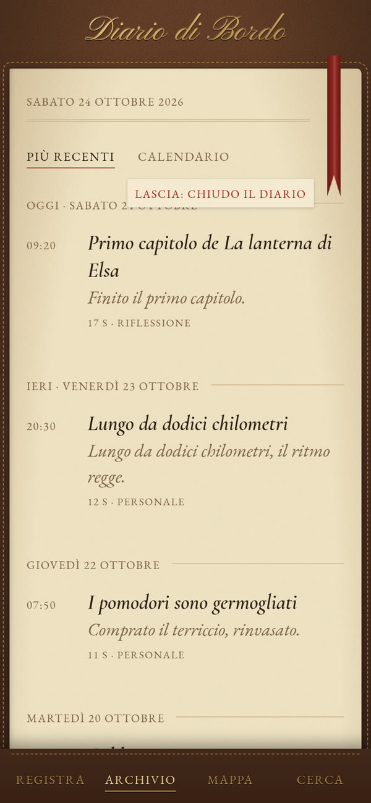
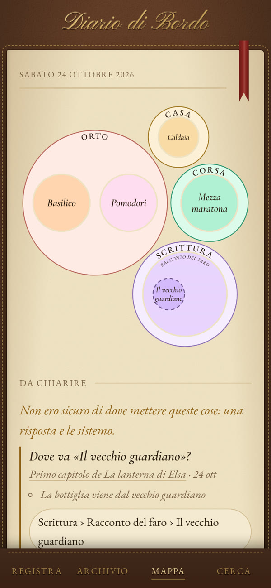

# Guida all'uso

Come si usa il Diario di Bordo dal telefono (o dal browser del PC). Per installarlo
vedi il [README](../README.md); per gestire persone, backup e aggiornamenti vedi
[amministrazione.md](amministrazione.md).

- [Entrare](#entrare)
- [Lo scaffale e i diari](#lo-scaffale-e-i-diari)
- [Registrare](#registrare)
- [L'archivio](#larchivio)
- [Le note](#le-note)
- [Le cose da fare](#le-cose-da-fare)
- [La mappa dei temi](#la-mappa-dei-temi)
- [Cerca o chiedi](#cerca-o-chiedi)
- [Il tuo account](#il-tuo-account)

## Entrare

Apri l'indirizzo del Diario: `http://localhost:8000` sul PC, l'indirizzo
`https://<pc>.<rete>.ts.net` dal telefono (te lo dà chi ha installato il Diario).
Entra con nome utente e password.

**Hai ricevuto un invito?** Tocca *Hai un invito? Crea il tuo account*, scrivi il codice
(maiuscole, minuscole e trattini non contano), scegli nome utente e password (almeno 12
caratteri). Entri subito e trovi già un diario pronto.

**Mettilo nella schermata Home** del telefono, così si apre a tutto schermo come un'app:
Chrome, menu ⋮ → *Aggiungi a schermata Home*; Safari, Condividi → *Aggiungi alla schermata Home*.
Consenti il microfono quando lo chiede.

## Lo scaffale e i diari

  
  

Dopo l'accesso compare lo **scaffale**: i tuoi diari, come quaderni di cuoio, l'ultimo
usato per primo. Ognuno è un mondo a sé: archivio, mappa dei temi, domande, cose da fare
e ricerca non passano mai da un diario all'altro. Puoi tenerne uno per tutto o uno per
ogni cosa (*Lavoro*, *Viaggio in Islanda*, *Idee*).

- **Aprire un diario**: toccalo. Si riapre alla pagina in cui l'avevi chiuso.
- **Chiudere il diario**: tira giù di poco il **nastro rosso** in cima alla pagina. Quando
  compare *Lascia: chiudo il diario*, lascialo: il diario si chiude a quella pagina e torni
  allo scaffale. Se preferisci un pulsante: *Chiudi il diario* in fondo all'Archivio.
  Durante una registrazione il diario non si chiude.
- **Nuovo diario**: l'ultima casella dello scaffale. Scegli il nome e il colore della copertina.
- **Rinominare, cambiare copertina, eliminare**: *modifica* sotto il diario. Per eliminarlo
  scrivi il suo nome e tieni premuto il pulsante: spariscono per sempre note, audio, mappa e
  cose da fare di quel diario. L'ultimo diario rimasto non si può eliminare.

Il colore della copertina è anche il cuoio intorno alla pagina: vedi sempre in quale diario sei.

## Registrare

  

1. Nel diario, sezione **Registra**, tocca il pulsante rosso e parla. Lo schermo resta acceso
   e l'audio viene salvato sul telefono ogni 5 secondi.
2. *Pausa* / *Riprendi* quando vuoi; tocca di nuovo il pulsante rosso per terminare.
3. Il vocale parte da solo verso il PC. Quando mostra **Conservato sul PC** l'originale è al
   sicuro e la copia sul telefono viene liberata.

Il vocale va nel diario in cui l'hai registrato, anche se nel frattempo ne apri un altro.

- **Senza rete**: resta *Sul telefono, da inviare* e parte al ritorno della connessione
  (anche dallo scaffale).
- **Pagina chiusa per sbaglio** durante una registrazione: alla riapertura quanto registrato
  viene recuperato e inviato.
- **Cancellare prima di inviare**: metti in pausa e tieni premuto **Elimina** per 2 secondi.
- **Caricare un file audio** (es. dai Memo Vocali, utile per registrare a schermo bloccato su
  iPhone): *Oppure carica un file audio*.

## L'archivio

  
  

Due viste, la scelta resta per la volta dopo:

- **Più recenti**: i vocali per giorno (Oggi, Ieri, …) con ora, titolo e prima frase.
  Lo stato compare solo finché la nota non è pronta.
- **Calendario**: il mese a griglia, un pallino per vocale. Tocca un giorno per vederne i
  vocali; cambia mese con le frecce o scorrendo il dito.

## Le note

  
  

Ogni vocale passa da *In coda per la trascrizione* a *Nota pronta*, di solito in pochi minuti
(tutto gira sul PC, nessun servizio esterno). Nella nota trovi:

- **titolo, data, temi** e l'**audio** (una copia MP3 per ascoltare; l'originale resta intatto);
- gli **appunti**: i tuoi pensieri riorganizzati, un gruppo per ogni argomento di cui parli,
  i punti in ordine logico e sotto ciascuno i dettagli. Un piccolo segno distingue decisioni,
  domande aperte e idee; le cose da fare hanno la casella;
- la **trascrizione**: tocca una frase per riascoltare quel momento. Se è sbagliata puoi
  correggerla: appunti e cose da fare si rifanno dal testo corretto;
- **chi parla**: se nel vocale ci sono più persone la trascrizione è divisa per interventi
  (Voce 1, Voce 2…). Tocca *nomi* accanto a *Trascrizione* per dare il nome vero a ogni voce;
- **da chiarire**: a volte il Diario chiede dove mettere un argomento (vedi sotto).

In fondo: scaricare la nota (JSON) o l'audio originale, ed **Elimina dal Diario** (tieni
premuto 2 secondi): sparisce tutto ciò che viene da quel vocale.

Il Diario segue una regola: niente che non sia nel vocale. Responsabili o scadenze che non
compaiono nella trascrizione vengono tolti, e ogni cosa da fare deve avere la frase che la
giustifica. Ogni intervento è negli avvisi in fondo alla nota.

## Le cose da fare

Sono gli impegni presi davvero ("domani lo chiamo"), in poche parole, dentro gli appunti e
raggruppati per tema sulla mappa. Un impegno già aperto detto di nuovo non si duplica
(*detta 2 volte*). Quando in un vocale dici di averlo fatto si spunta da solo, con il vocale
che lo dice; puoi sempre togliere o mettere la spunta a mano.

## La mappa dei temi

  
  

I temi nascono solo da ciò che racconti, senza categorie decise in anticipo. Un tema è una
cosa che torna (un progetto, un luogo, una persona, un interesse); ogni argomento si colloca
con un percorso dal più ampio al più specifico, per esempio *Orto › Pomodori › semina*.

- **La mappa**: i temi più ampi sono isole, le loro parti bolle dentro; più note, bolla più
  grande. Tocca un'isola per avvicinarla, poi un tema per aprirne la scheda; tocca fuori per
  risalire.
- **La scheda di un tema**: a che punto è (riscritto a ogni vocale che ne parla), le sue parti,
  le cose da fare, gli appunti di tutti i vocali dal più recente. Una decisione cambiata o una
  domanda risolta resta barrata dove era stata detta.
- **Da chiarire**: se il Diario non è sicuro di dove va qualcosa, il tema nasce *provvisorio*
  (tratteggiato) e compare una domanda, al massimo due per vocale. Rispondi con un tocco o a
  parole con *altro…*: la risposta vale per sempre. Le trovi tutte in fondo alla mappa, in
  *Cosa mi hai detto*.
- **Correggere a mano**: dalla scheda puoi *spostare* un tema dentro un altro o *rinominarlo*
  (con il nome di un tema allo stesso livello, i due diventano uno).
- Ogni tanto il Diario **riordina l'albero**: raggruppa temi che si rivelano parti di una
  stessa cosa, unisce i doppioni. Non tocca i temi che hai corretto tu.

## Cerca o chiedi

  
  

Una sola casella. Mentre scrivi compaiono temi, cose da fare e note (per parole, anche in
forme diverse, e per significato). Premi Invio o *Chiedi* per una risposta in italiano:
"cosa ho deciso col commercialista?", "cosa devo fare questa settimana?", "di cosa ho parlato
ieri?". Ogni numero tra parentesi apre la nota nel punto dell'audio in cui se ne parla.
Periodo e tema restringono ricerca e domande. Si cerca solo nel diario aperto.

## Il tuo account

Dallo scaffale, *Il mio account*: cambi la password (gli altri tuoi dispositivi dovranno
rientrare) ed esci. Se ti hanno dato una **password provvisoria**, al primo accesso il Diario
ti chiede di sceglierne una tua.

I tuoi diari li vedi solo tu: nemmeno l'amministratore li vede dall'app.

## Se qualcosa non va

| Cosa vedi | Cosa fare |
|---|---|
| Pagina bianca o senza stile dopo un aggiornamento | Ricarica la pagina; sul PC Ctrl+Maiusc+R. Sul telefono chiudi e riapri l'app |
| *Il PC non risponde* | Il PC è spento o sospeso, o Tailscale è spento sul telefono |
| *Il microfono richiede una connessione HTTPS* | Usa l'indirizzo `https://…ts.net`, non un IP |
| Il vocale resta *In coda* a lungo | L'elaborazione sul PC è ferma: avvisa chi lo gestisce |
| Ti rimanda allo scaffale | Nessun diario è aperto su questo dispositivo (per esempio dopo un nuovo accesso): toccane uno |
